# Earthrise.World — MVP assets

**Status:** Decided by the owner, 2026-10-31. This is the catalogue of the MVP's voxel assets, which live in [`Assets/`](../Assets/), in the format of [ADR-005](ADR/ADR-005-content-formats.md). They come from the owner's package, which is kept unchanged in [Reference/SiegePrototype/](Reference/SiegePrototype/). [GameDesign.md](GameDesign.md) and [GameDescription.md](GameDescription.md) govern rules and behaviour; this document and [RendererLook.md](RendererLook.md) govern size, colour and shading.

Every asset uses 0.5 m voxels, so one voxel is 0.125 m³. Sizes are given as width × height × depth, with depth measured front to back.

## Templates

Buildings, used by both the simulation and the client. The costs are counted under ADR-005, with decorations costed as the material they sit in. Stock and foundations are left out.

| Id | Template | Size (m) | Cost | Critical part | Notes |
|---|---|---|---|---|---|
| T1 | Hall | 11 × 6.5 × 7 | 124 m³ timber | Hall frame (the whole building) | The drop site for everything. The hall is the keep until the keep is complete. |
| T2 | Keep | 12 × 21.5 × 15 | 1,375.5 m³ stone + 2.875 m³ timber | Great tower | 12 × 12 m and 16 m high, with a forebuilding. The 21.5 m includes the banner. Hollow: 1.5 m walls with floors. |
| T3 | Stone wall, standard | 8 × 6.5 × 1.5 | 72 m³ stone | None: a section opens by the breach rule | 5.5 m of wall and 1 m of merlons. That is the same 72 m³ as GameDescription.md's 8 × 1.5 × 6 m. |
| T4 | Tower | 7 × 12 × 7 | 410 m³ stone | Firing platform | Hollow. Arrow slits are decorations. |
| T5 | Gatehouse | 9 × 12 × 7 | 578.5 m³ stone + 7 m³ timber | Gate | The garrison fires down into the passage. |
| T6 | Palisade | 8 × 4 × 2 | 18.625 m³ timber | None | |
| T7 | Palisade gate | 8 × 4.5 × 1 | 15.5 m³ timber | Gate | The grid has 1 m of padding in front, which the baker trims. |
| T8 | Quarry yard | 8 × 3.5 × 6 | 20.25 m³ timber | Shed | The stone drop site. Its stone stack is stock. |
| T9 | Lumber camp | 7.5 × 3 × 6 | 18.5 m³ timber | Shed | The timber drop site. Its log stack is stock. |

## Models

Drawn by the client only. Models set no costs and no rules (ADR-005, decision 8). Each unit type is one 1 × 1 × 4 figure with one cue that tells it apart.

| Id | Model | Figure (voxels) | Cue |
|---|---|---|---|
| U1 | Laborer | 2 × 5 × 1 | Tan body, bare head, pick on the shoulder |
| U2 | Spearman | 2 × 7 × 1 | Spear tip 1.5 m above the helmet |
| U3 | Archer | 2 × 5 × 1 | Leather hood, bow tip at the shoulder |
| U4 | Outrider | 1 × 5 × 5 | A horse, 2.5 m tall |
| U5 | Man-at-arms | 2 × 4 × 2 | All iron, with a faction shield in front |
| S2 | Sapper | 3 × 5 × 1 | Iron shoulders, raised pick |
| S1 | Battering ram | 3 × 3.5 × 7.5 m | Hide roof, iron-headed log |
| S3 | Trebuchet | 11.5 × 13 × 3.5 m | 12 m arm, counterweight. A static model in the MVP. |

## Illustrations

These are for documentation and tests, and are never baked:
- **Squads:** U1–U5 and S2, in groups of six (outriders in threes).
- **E1, ditch and rampart:** the standard ditch profile.
- **E2, deep foundation:** a 42 m³ wall on a 36 m³ foundation that reaches bedrock 3 m down, cut away at the front.
- **M1, ground strata:** grass, earth, common rock, a lens of building stone, and bedrock.
- **M2, rubble keeps its material:** heaps of stone, timber and earth rubble.

## Decided with the package

The package made choices the design documents had not fixed. The owner adopted them with the package:

- **Proportions:** the hall, keep, gatehouse, tower and drop sites as in the table above.
- **Critical parts:** the hall's frame and each drop site's shed, as well as the gate, the firing platform and the great tower that GameDescription.md already names.
- **Hollow buildings:** towers and the keep are hollow, with 1.5 m walls and floors, so they cost less than their outline.
- **The standard ditch** is 5 m wide at the top and 2 m deep, with 1:1 sides. Those are 45°, the slope at which earth stands. The rampart is built from the spoil on the side towards the keep.
- **Unit cues:** one cue per unit type, as listed under Models.
- **Render-only colours:** horse #5e4330, leather (hides and hoods) #6e5a3e, timber rubble #5f4530 and earth rubble #7d6044. Rock rubble is #7f7c77, which is provisional.

## Known issues

- **E1's rampart holds 44 m³ against 40 m³ dug.** The spoil and the rampart must be equal, as GameDescription.md and the package's own notes both say, so the profile needs solving again.
- **E1's new rampart is topped with grass.** Under RendererLook.md only the generator places grass, so a fresh rampart is bare earth. E1 is an illustration, so this affects nothing that is baked.
- **The package's costs left decorations out.** `Manifest.json` keeps each original figure as `packageCostM3`, next to the recount.
- **The key scene builds its own walls 7 m high.** The T3 template is 6.5 m including its merlons. Where they differ, the templates win (MvpPlan.md, M1).

## Previews

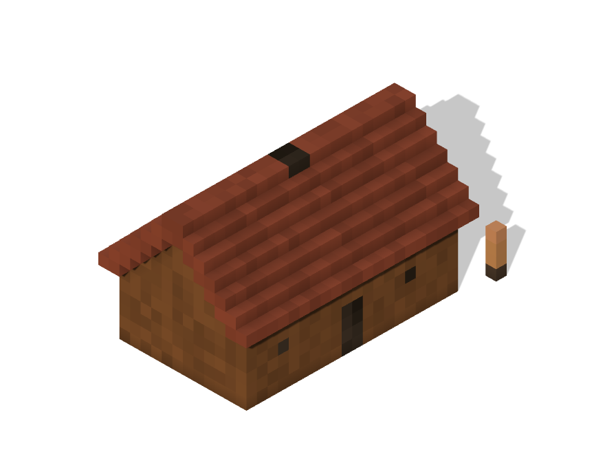
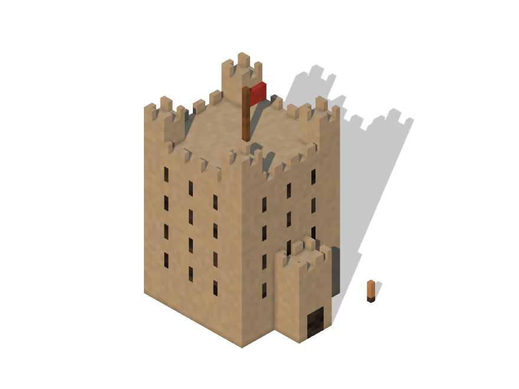
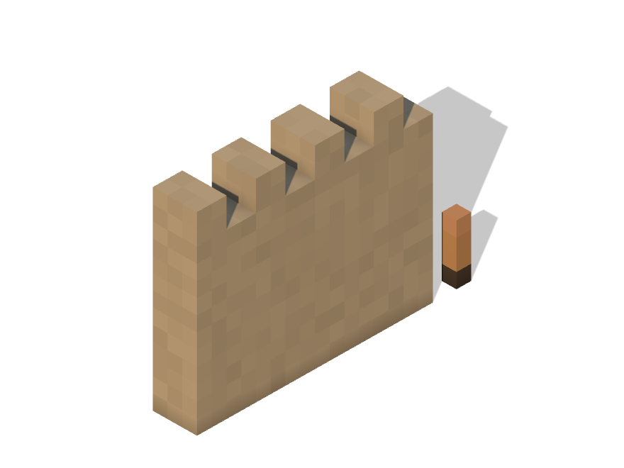
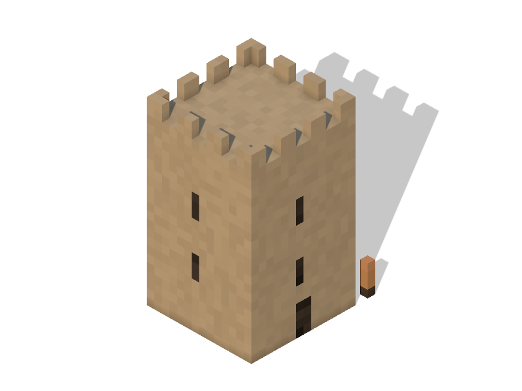
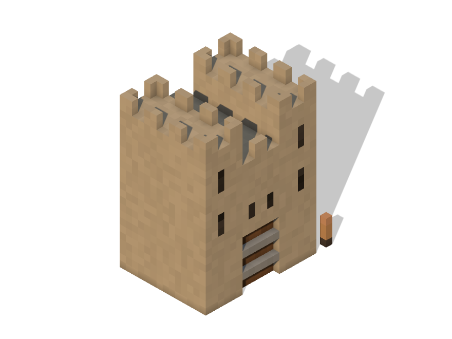
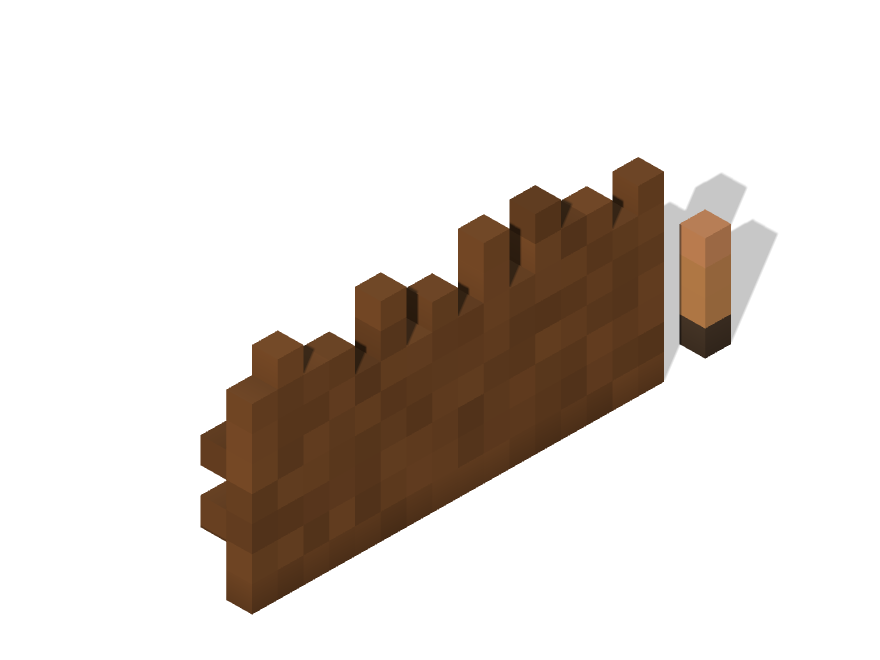
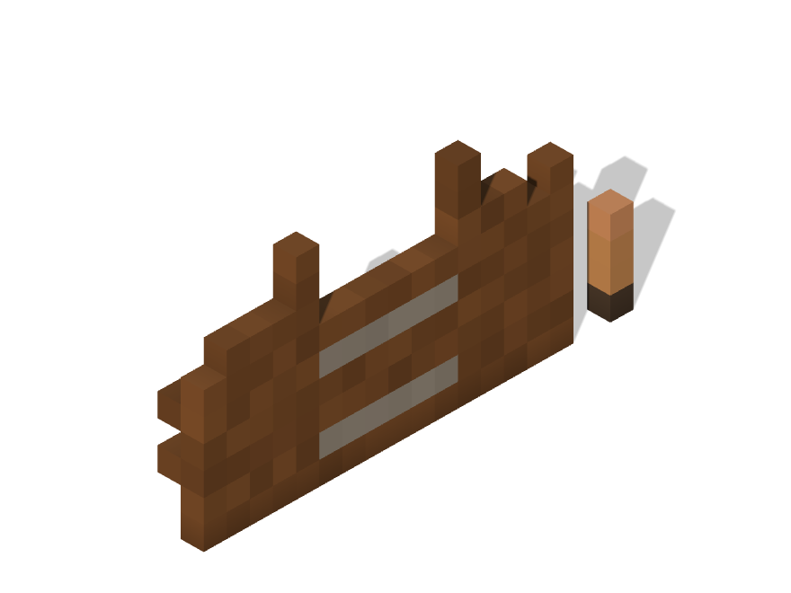
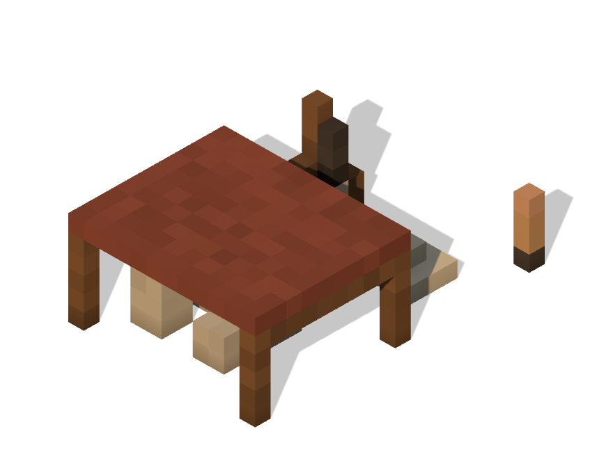
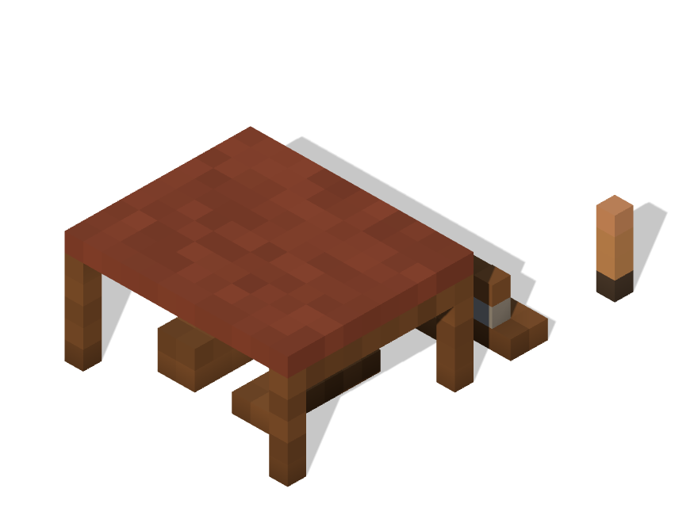

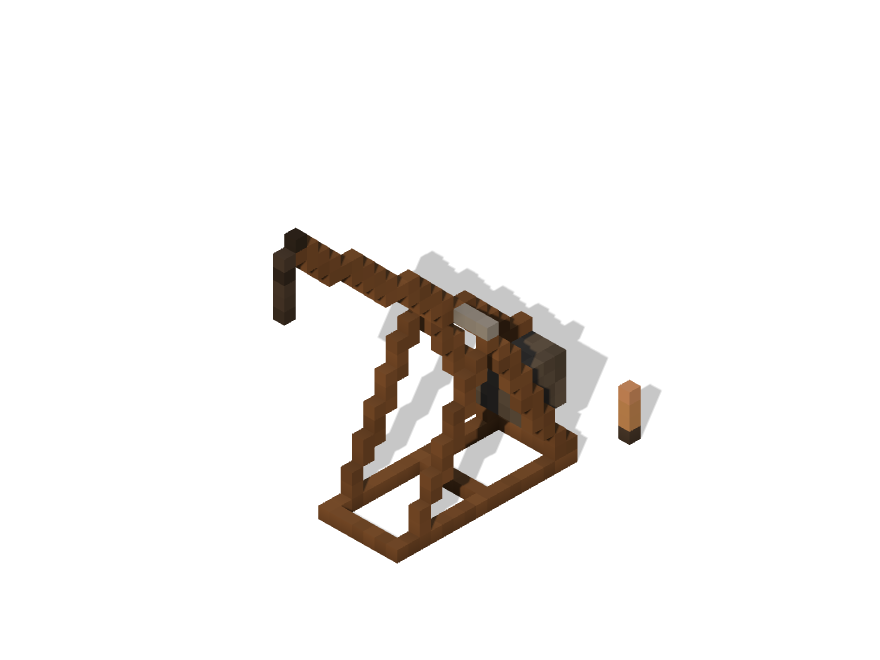
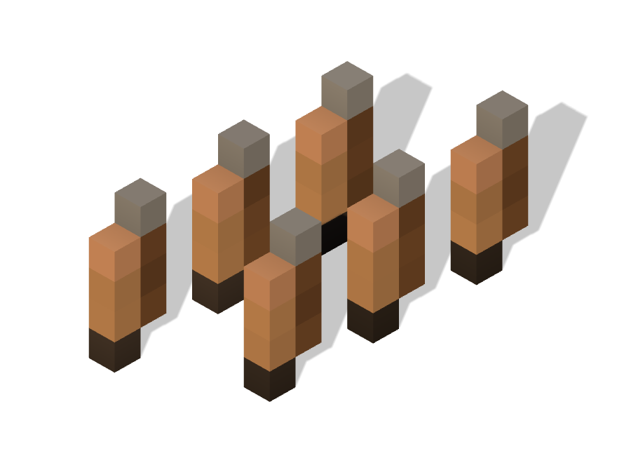

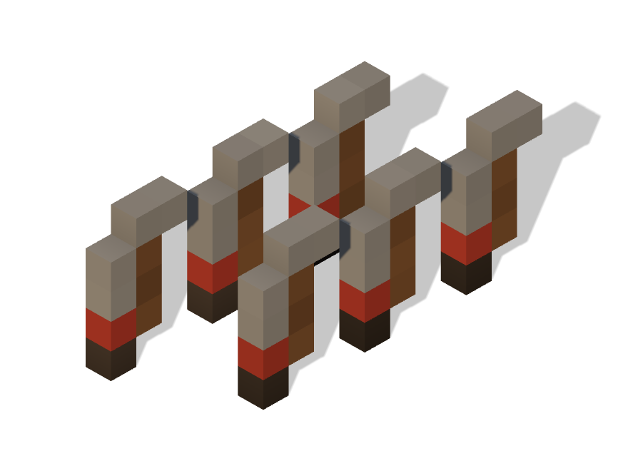
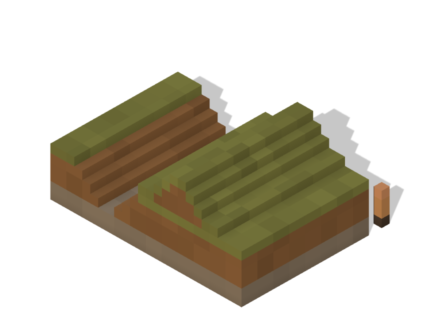
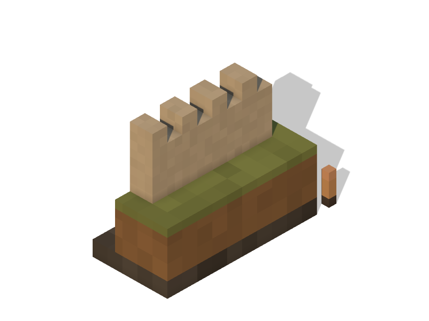
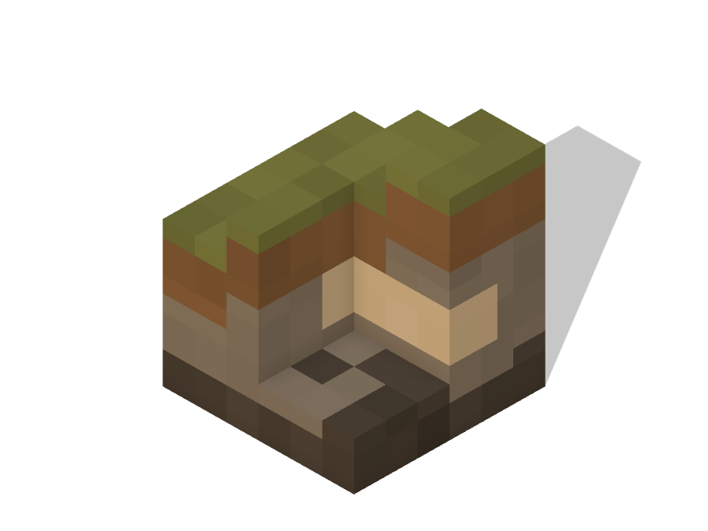
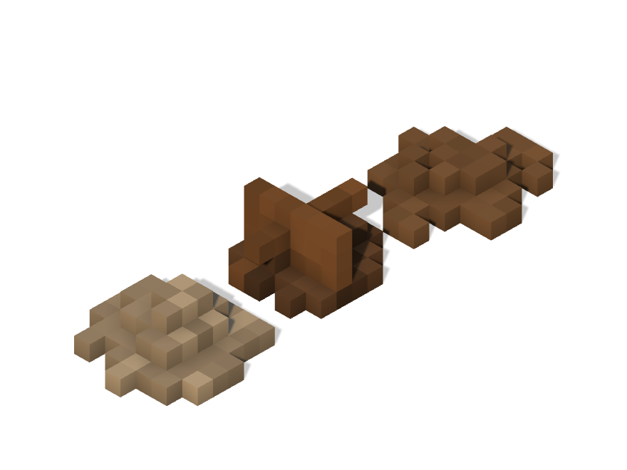
