# Earthrise.World — MVP assets

**Status:** Decided by the owner, 2026-10-31. This is the catalogue of the MVP's voxel assets, which live in [`GameData/`](../GameData/), in the format of [ADR-005](ADR/ADR-005-content-formats.md). Templates and the palette are under `GameData/Server/`, models under `GameData/Client/`, and illustrations under `GameData/Illustrations/` ([ADR-008](ADR/ADR-008-server-and-client-game-data.md)). They come from the owner's second package, kept unchanged in [Reference/SiegePrototypeV2/](Reference/SiegePrototypeV2/). It replaced the first, which is still kept in [Reference/SiegePrototype/](Reference/SiegePrototype/). [GameDesign.md](GameDesign.md) and [GameDescription.md](GameDescription.md) govern rules and behaviour; this document and [RendererLook.md](RendererLook.md) govern size, colour and shading.

Assets come in two voxel sizes ([ADR-006](ADR/ADR-006-voxel-sizes.md)):
- **World assets** use 1 m voxels, so one voxel is 1 m³. These are the templates, the earthworks and the material samples. Their file names end in `-1m`.
- **Models** use 0.5 m voxels, so one voxel is 0.125 m³. These are units, engines and squads. Their file names end in `-05m`.

Sizes are given as width × height × depth, with depth measured front to back. The world assets are automatic conversions from the first package's 0.5 m drawings, and are to be redrawn natively at 1 m (Known issues).

## Templates

Buildings, used by both the simulation and the client. The costs are counted under ADR-005, with decorations costed as the material they sit in. Stock and foundations are left out.

| Id | Template | Size (m) | Cost | Critical part | Notes |
|---|---|---|---|---|---|
| T1 | Hall | 11 × 7 × 7 | 188 m³ timber | Hall frame (the whole building) | The drop site for everything. The hall is the keep until the keep is complete. The roof costs as timber. |
| T2 | Keep | 12 × 19 × 15 | 1,650 m³ stone, 120 m³ timber | Great tower | A 12 × 12 m great tower with a forebuilding in front. Hollow: 2 m stone walls with a timber floor every 5 m, and a stone roof carried by a 2 × 2 m stone pier up the middle, because stone spans 2 m (GameDesign.md, *2026-10-31: the paper tests' values*). A row of slits on each face, one every 3 m at each storey. |
| T3 | Stone wall, standard | 8 × 7 × 2 | 96 m³ stone | None: a section opens by the breach rule | 5 m of solid wall and 2 m of crenellation above it. That is the same 96 m³ as GameDescription.md's 8 × 2 × 6 m. |
| T4 | Tower | 7 × 12 × 7 | 479 m³ stone | Firing platform | Hollow, with 2 m walls. The platform is the top 3 m, merlons included. A slit on each face at each storey. |
| T5 | Gatehouse | 9 × 12 × 7 | 585 m³ stone + 12 m³ timber | Gate | The gate is 3 m wide and 4 m high. The garrison fires down into the passage. |
| T6 | Palisade | 8 × 4 × 2 | 35 m³ timber | None | |
| T7 | Palisade gate | 8 × 5 × 1 | 32 m³ timber | Gate | Its iron fittings cost as timber. The grid has 1 m of padding in front, which the baker trims. |
| T8 | Quarry yard | 7 × 3 × 6 | 41 m³ timber | Shed | The stone drop site. Its stone stack is stock. The shed stands on four corner posts. |
| T9 | Lumber camp | 7 × 3 × 6 | 38 m³ timber | Shed | The timber drop site. Its log stack is stock. The shed stands on four corner posts. |

## Models

Drawn by the client only. Models set no costs and no rules (ADR-005, decision 8). Each unit type is one figure: a body of 1 × 1 × 4 voxels, 0.5 × 0.5 × 2 m, with one cue beside it that tells it apart. Far away, units are drawn as impostors (RendererLook.md).

| Id | Model | Figure (voxels) | Size (m) | Cue |
|---|---|---|---|---|
| U1 | Laborer | 2 × 5 × 1 | 1 × 2.5 × 0.5 | Tan body, bare head, pick on the shoulder |
| U2 | Spearman | 2 × 7 × 1 | 1 × 3.5 × 0.5 | Spear tip 1.5 m above the helmet |
| U3 | Archer | 2 × 5 × 1 | 1 × 2.5 × 0.5 | Leather hood, bow tip at the shoulder |
| U4 | Outrider | 1 × 5 × 5 | 0.5 × 2.5 × 2.5 | A horse, 2.5 m tall |
| U5 | Man-at-arms | 2 × 4 × 2 | 1 × 2 × 1 | All iron, with a faction shield in front |
| S2 | Sapper | 3 × 5 × 1 | 1.5 × 2.5 × 0.5 | Iron shoulders, raised pick |
| S1 | Battering ram | 6 × 7 × 15 | 3 × 3.5 × 7.5 | Hide roof, iron-headed log |
| S3 | Trebuchet | 23 × 26 × 7 | 11.5 × 13 × 3.5 | 12 m arm, counterweight. In the MVP it switches between three baked poses, packed, cocked and released. The package draws one; the other two are still to draw. |

The figures are the same as in the first package, which already drew them at 0.5 m.

**Placeholders** for the renderer spike's test scene (MvpPlan.md, M1 task 9), which `GameData/` lacked. They are drawn to the v5 scene's shapes, and the owner may replace them:

| Id | Model | Size (voxels) | Size (m) | Cue |
|---|---|---|---|---|
| P1 | Mantlet | 5 × 4 × 3 | 2.5 × 2 × 1.5 | A timber screen braced from behind, its front +z |
| P2 | Banner | 7 × 14 × 1 | 3.5 × 7 × 0.5 | A 7 m pole with a 3 m faction flag |

The scene's trees and cottages are not models. They are 1 m world voxels, as ADR-006 puts trees, drawn by the scene script. Its quarry stock is T8's, whose template holds it.
## Illustrations

These are for documentation and tests, and are never baked:
- **Squads** (0.5 m): U2–U5 and S2, in groups of six (outriders in threes). U1 shows six laborers together, though laborers are not in squads (GameDesign.md, 2026-10-31).
- **E1, ditch and rampart** (1 m): the standard ditch, with its spoil as a rampart 2 m high on the side towards the keep.
- **E2, deep foundation** (1 m): a 56 m³ wall on a 48 m³ foundation that reaches bedrock 3 m down, cut away at the front.
- **M1, ground strata** (1 m): grass, earth, common rock, a lens of building stone, and bedrock.
- **M2, rubble keeps its material** (1 m): heaps of stone, timber and earth rubble.

## Decided with the packages

The packages made choices the design documents had not fixed. The owner adopted them with the packages:

- **Proportions:** the hall, keep, gatehouse, tower and drop sites as in the table above.
- **Critical parts:** the hall's frame and each drop site's shed, as well as the gate, the firing platform and the great tower that GameDescription.md already names.
- **Hollow buildings:** towers and the keep are hollow, with 2 m walls and floors, so they cost less than their outline. The first package's walls were 1.5 m, which the 1 m grid cannot draw.
- **The standard ditch** is 5 m wide at the top and 2 m deep, with 1:1 sides. Those are 45°, the slope at which earth stands. On the 1 m grid the sides step: 4 m wide in the top metre and 2 m in the second, which is 6 m² of cross-section, the same as the 1:1 profile. The rampart is built from the spoil on the side towards the keep.
- **Unit cues:** one cue per unit type, as listed under Models.
- **Render-only colours:** horse #5e4330, leather (hides and hoods) #6e5a3e, timber rubble #5f4530 and earth rubble #7d6044. Rock rubble is #7f7c77, which is provisional.

## Known issues

- **The world assets are automatic conversions.** The package made each 1 m voxel from the majority of 2 × 2 × 2 voxels of the 0.5 m drawing. T1–T7 are to be redrawn natively at 1 m before the M4 Siege castle is final, and T8 and T9 before M6.
- **T8's and T9's sheds had no posts** (fixed 2026-10-31, the owner's decision). The conversion dropped the 0.5 m posts, so T9's roof touched nothing and T8's stood only on its stone stack, which is stock ([ADR-004](ADR/ADR-004-rule-based-destruction.md)). Each now stands on four timber corner posts 2 m tall, and T8's stray post, all that the conversion left of its lifting frame, is joined to the ground by one voxel. The asset check tests for this (ADR-005). Their previews in `Design/Previews/` predate the posts.
- **E1 does not hold its own spoil.** The rampart holds 48 m³ against 32 m³ dug, and the spoil and the rampart must be equal (GameDescription.md). The conversion flattened the ditch to 3 m wide and 1 m deep, with a 1 m slot 2 m deep. Redrawing the ditch at the decided profile digs exactly 48 m³ for its 8 m, which fixes both without touching the rampart.
- **E1's new rampart is topped with grass.** Only the generator places grass (RendererLook.md), so a fresh rampart is bare earth. E1 is an illustration, so this affects nothing that is baked.
- **T2's banner was removed.** The conversion dropped its pole and left two faction voxels floating. Banners are 0.5 m models (ADR-006). T2's preview still shows the banner. The render-fix package's T2 brought the two voxels back, and they were removed again.
- **The first conversion lost the openings** (fixed 2026-11-01, from the render-fix package in [Reference/RenderFixPackage/](Reference/RenderFixPackage/)). A majority vote over 2 × 2 × 2 blocks let a 0.5 m slit lose to the stone around it: the keep kept 4 openings of 54, and the gatehouse none. The package's conversion lets an opening win any block it touches, and T1, T2, T4 and T5 were taken from it. Its asset sheet draws slits on only two faces of the keep and the towers, so the other two faces were given the same pattern (the owner's choice). An opening costs as the stone it sits in (ADR-005), so the package's lower stone figures for T2, T4 and T5 are not used. The previews in `Design/Previews/` predate the openings.
- **T2's roof is stone on a pier** (2026-11-01, the owner's choice). The render-fix package made the keep's floors and roof stone again, but an 8 × 8 m stone roof cannot stand where stone spans 2 m: the support search finds 16 of its voxels unsupported. The floors stay timber, and a 2 × 2 m stone pier up the middle carries a stone roof, with every roof voxel within 2 m of support. The support search finds nothing unsupported in it. T2's preview shows a stone roof and no pier.
- **The package's costs left decorations out.** `Manifest.json` keeps each original figure as `packageCostM3`, next to the recount. T1, T2, T4 and T7 cost slightly more than the package said.
- **The scene prompt builds its walls 1.5 m thick.** T3 is 2 m. Where they differ, the templates win ([MvpPlan.md](MvpPlan.md), M1).

## Previews

The previews are the package's own renderings, kept in [Previews/](Previews/) rather than beside their sources in `GameData/`; nothing reads them.

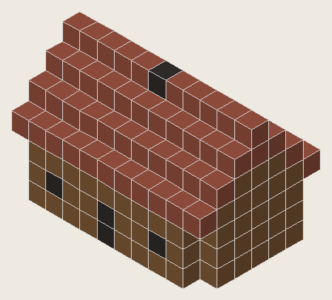
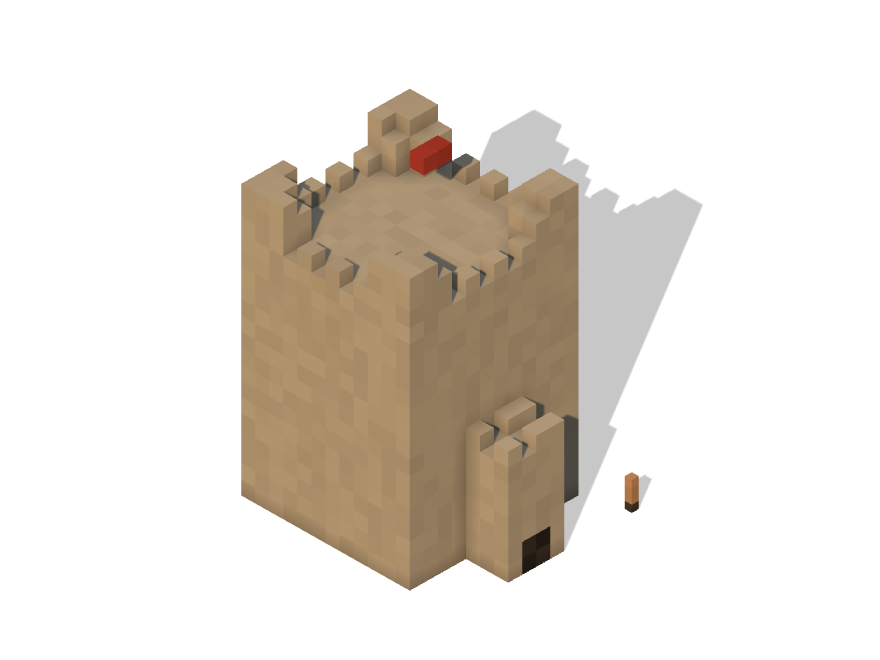
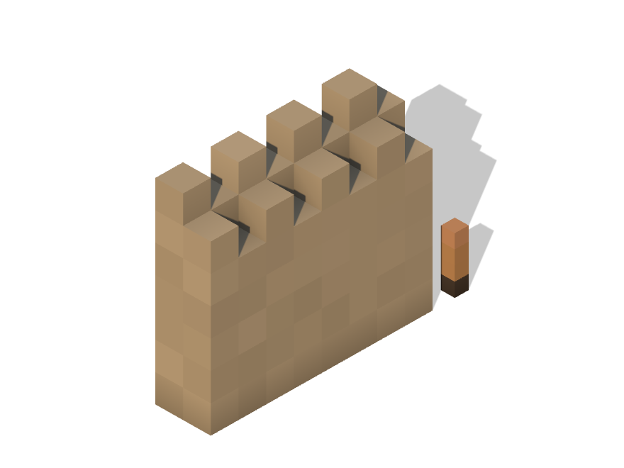
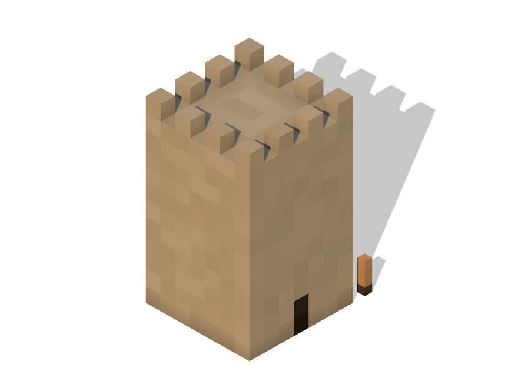
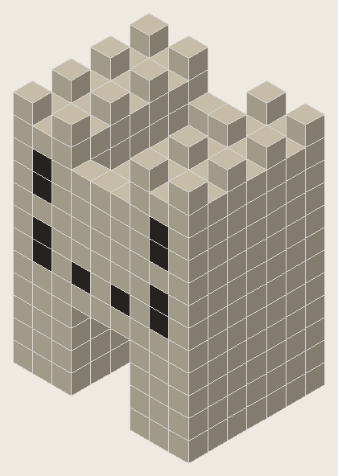
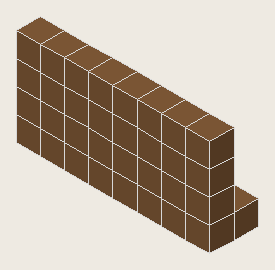
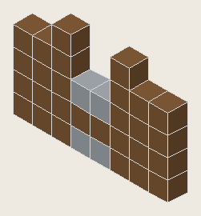
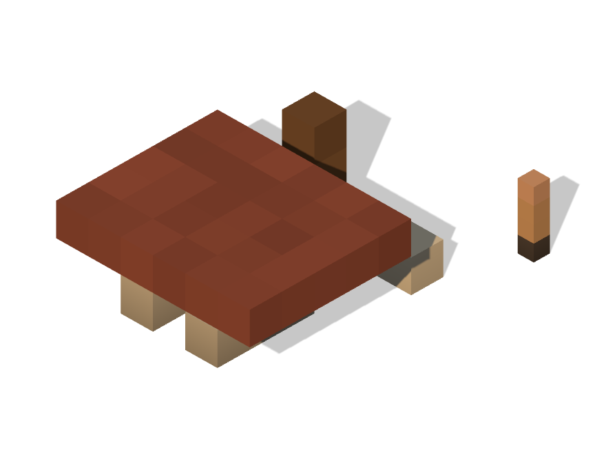
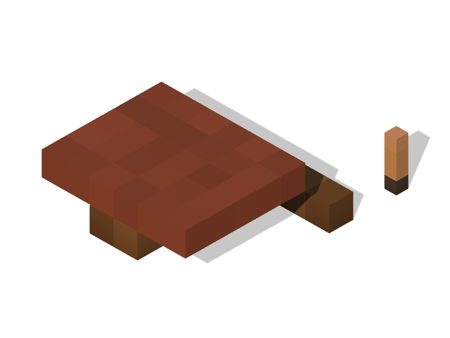
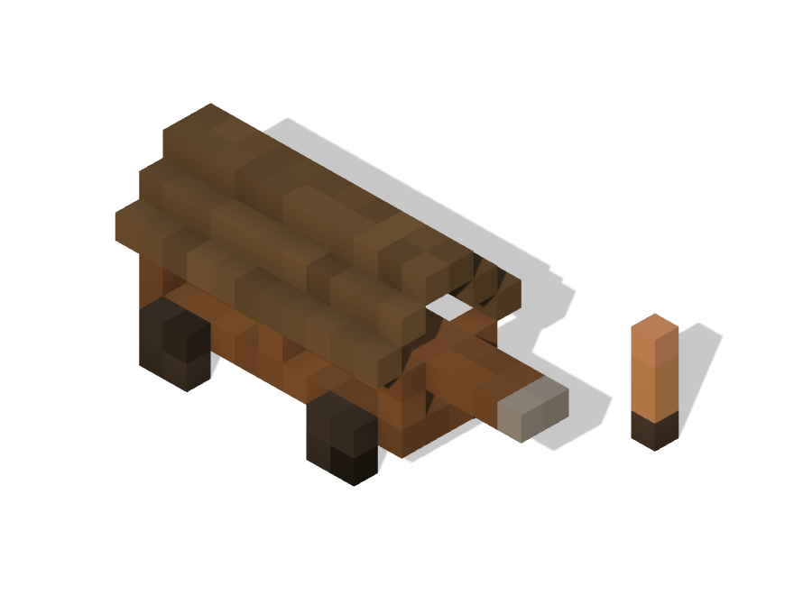

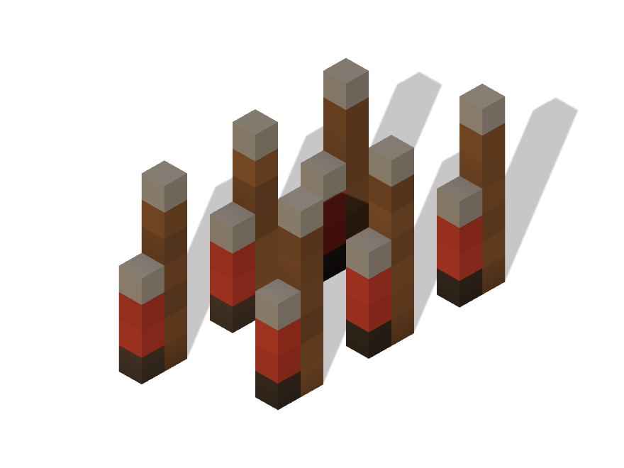
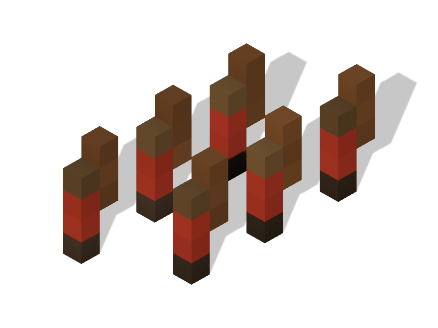
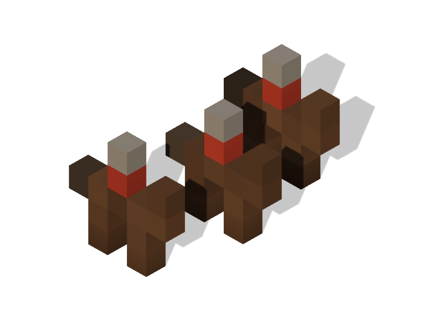
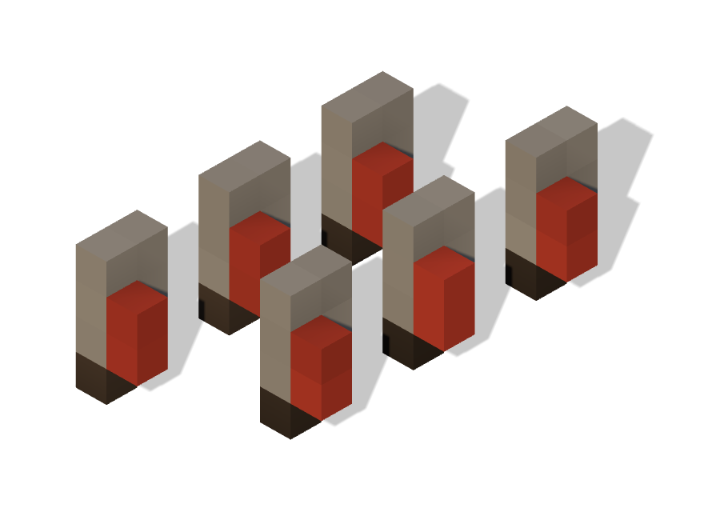

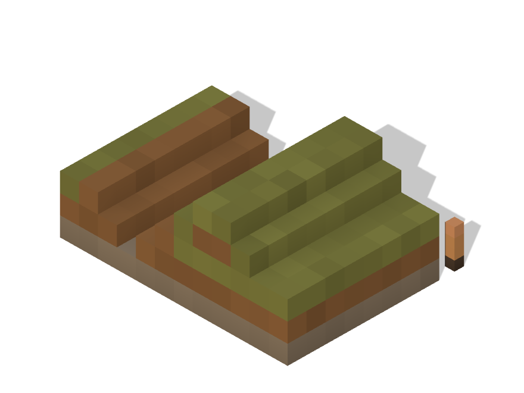
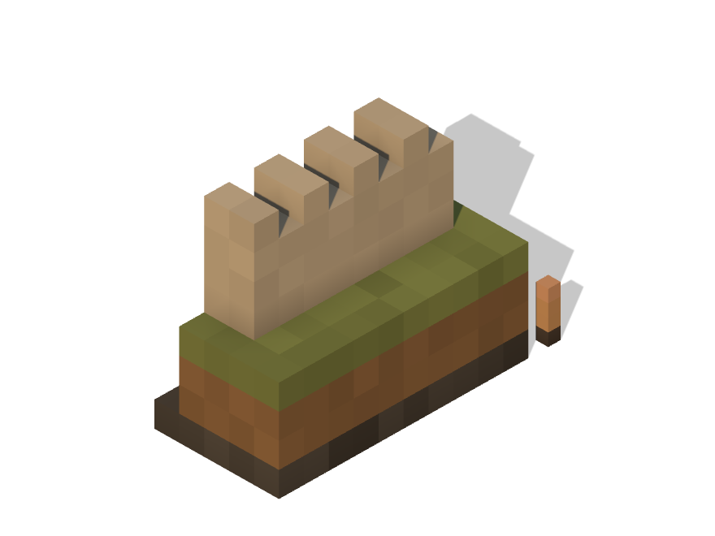
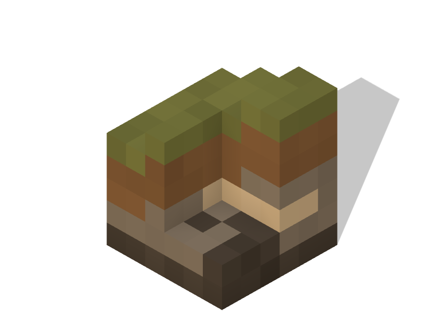
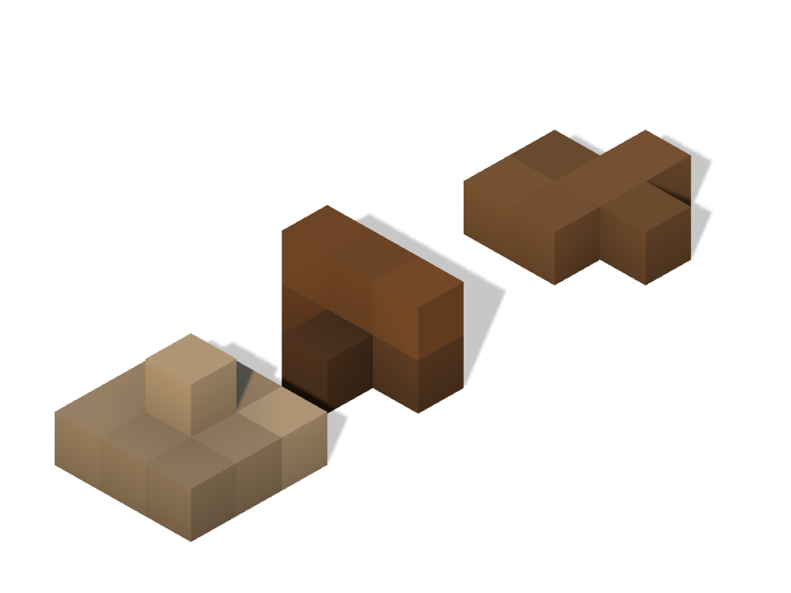
